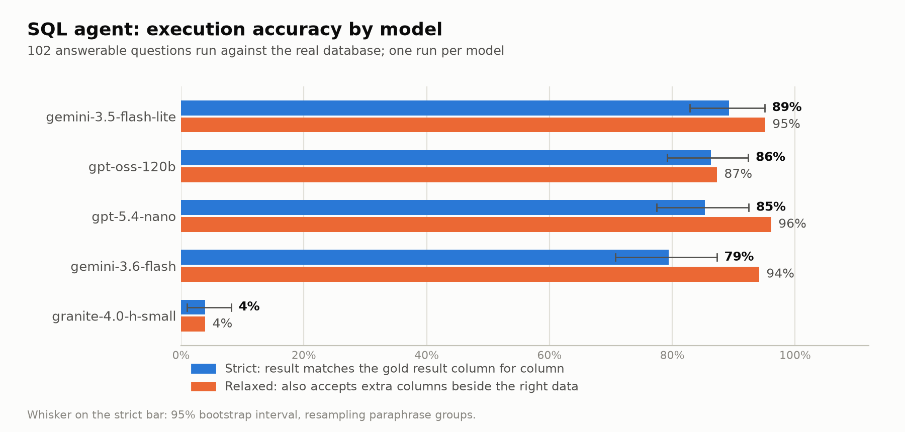
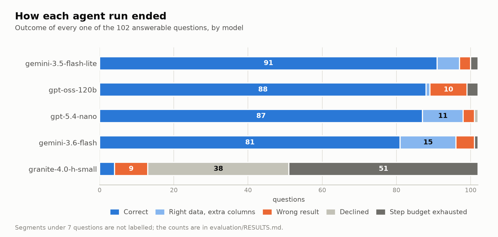
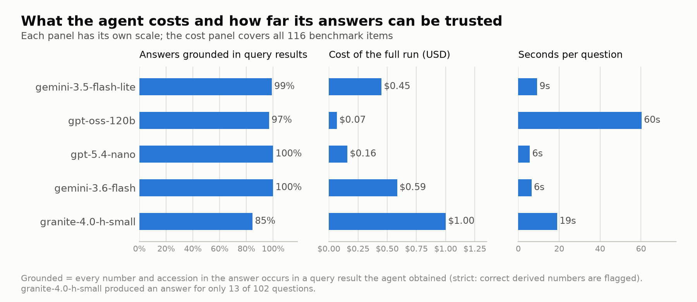

# 🧬 UniProt SQL Agent

[](LICENSE)
[](https://www.python.org/)

Ask natural-language questions about human proteins. An LLM **agent** inspects a Postgres database built from
UniProt (12,000 reviewed entries, 20 tables), looks up the exact stored values, runs **read-only SQL**, repairs
its own errors, and answers from the rows. Every step is shown, and numbers in the answer are checked against
the result.

Live demo: [huggingface.co/spaces/RohanRamesh/proteinRAG](https://huggingface.co/spaces/RohanRamesh/proteinRAG)
(deployed by hand; it may still be running the earlier single-shot version until it is redeployed).

```
question
   │
   ▼
┌──────────────────────────── agent loop (≤ 8 steps) ─────────────────────────────┐
│  LLM picks one action as JSON ──► list_tables │ describe_table │ search_values   │
│        ▲                          run_sql ──► guard ► read-only txn ► timeout    │
│        └── observation (rows, or the SQL error / guard rejection) ◄── ► row cap   │
│  finish with  answer(text, from_query)  or  decline(reason)                      │
└──────────────────────────────────────────────────────────────────────────────────┘
   │
   ▼
answer + SQL + rows + step trace + grounding check
```

## Why an agent (and why not "RAG")

The schema is small enough to hand to a model whole; what a model cannot know is *how the data is stored*:
`proteins.organism` is `'Homo sapiens (Human)'`, a pathway is `'Protein modification; protein ubiquitination.'`,
`interactions.interaction_type` holds `NbExp=18`, and `mutagenesis.effect` is never filled. A single prompt
guesses; an agent looks, runs, reads the error and corrects. There is no retrieval over documents or embeddings,
so this is not RAG, and it is not called that. See [docs/LIMITATIONS.md](docs/LIMITATIONS.md).

Whether the agent is actually better is measured, not asserted. [evaluation/](evaluation/) compares the original single-shot
pipeline (kept in `baseline/`), the same prompt plus the column notes, and the agent, on 116 questions executed against the
real database, for five models (Claude Sonnet 5 only for the single-shot arms, on cost):

| execution accuracy (strict / relaxed) | original prompt | + column notes | agent |
|---|---|---|---|
| gemini-3.5-flash-lite | 89% / 90% | **96% / 97%** | 89% / 95% |
| gemini-3.6-flash | 87% / 92% | **95% / 97%** | 79% / 94% |
| gpt-oss-120b | 82% / 84% | **90% / 93%** | 86% / 87% |
| gpt-5.4-nano | 80% / 85% | 83% / 88% | 85% / **96%** |
| granite-4.0-h-small | 31% / 33% | **38% / 38%** | 4% / 4% |

**The honest reading:** the biggest gain came from telling the model how the data is stored (the column notes), not from the
agent loop. On the relaxed metric the agent is within a few points of the notes-only prompt for the two Gemini models, ahead for nano and
behind for gpt-oss (87% vs 93%), at 1.6–4.3× the cost and 2–4× the latency, and it falls apart with a weak model. What it does add is behavioural: it fabricated rows on 0–1 of 5
unanswerable questions (the single-shot arms: 1–5), emitted unsafe SQL in 0 of 45 hostile trials, and its answers were
grounded in its query results 97–100% of the time. Details, caveats and the full tables: [evaluation/RESULTS.md](evaluation/RESULTS.md).

### The agent's results



Strict accuracy requires the result to match the gold result column for column. Relaxed also accepts the right data with extra
columns, which is the main reason `gemini-3.6-flash` sits at 79% strict and 94% relaxed.



`granite-4.0-h-small` could not drive the tool protocol: it declined 38 questions and ran out of steps on 51. The four capable
models end in a wrong result on 3–10 of 102 questions and run out of steps on at most 3.



The charts are drawn from `evaluation/results/agent/scores.json` by `python -m evaluation.make_figures` (needs `matplotlib`).
One run per model: gaps of a few points between models are within the intervals shown.

## Safety: five independent layers

A generated query is never trusted because it *looks* safe.

| layer | what it stops | where |
|---|---|---|
| AST guard | anything but one `SELECT`: writes, data-modifying CTEs, `SELECT INTO`, row locks, `pg_*`/`lo_*`/`dblink` functions, catalog and foreign-schema tables | `agent/guard.py` (PostgreSQL's own parser, `pglast`) |
| read-only transaction | any write, even from a privileged role | `agent/database.py` |
| statement timeout | runaway queries (cartesian joins) | `agent/database.py` |
| row cap | unbounded results, however the query is written (server-side cursor, 200 rows) | `agent/database.py` |
| least-privilege role | everything else; the app warns on startup if `DATABASE_URL` is not `SELECT`-only | [docs/SETUP.md](docs/SETUP.md) |

The previous guard was a first-keyword check: a red-team of 18 hostile statements got 13 past it. Same statements,
before and after: [evaluation/results/redteam.md](evaluation/results/redteam.md).

## Project layout

```
agent/        the SQL agent: loop, tools, guard, read-only database layer, LLM adapters, grounding check
baseline/     the original single-shot pipeline, kept as the comparison arm (not used by the app)
db/           schema.sql, annotations.sql (column semantics), init/connection helpers
ingest/       UniProt fetch + parse + load (idempotent)
evaluation/   benchmark, harness, red-team, results  → evaluation/README.md
tests/        pytest: 159 tests (parser, guard, database containment, agent loop, harness self-tests, app)
docs/         SETUP.md, LIMITATIONS.md, ER diagram
app.py        Gradio front-end (rate-limited, shows the agent's steps)
```

## Quickstart

Full walkthrough (Postgres provisioning, read-only role, ingestion, Hugging Face deployment): [docs/SETUP.md](docs/SETUP.md).

```bash
python -m venv .venv && source .venv/bin/activate
pip install -r requirements-ingest.txt

cp .env.example .env     # GEMINI_API_KEY, GEMINI_MODEL (pinned id), DATABASE_URL, INGEST_DATABASE_URL

python -m db.init_db                          # schema + column notes
python -m ingest.fetch_uniprot                # ~120 MB download
python -m ingest.parse_and_load --truncate    # loads the first 12,000 entries

python app.py
```

## Known limits

Read [docs/LIMITATIONS.md](docs/LIMITATIONS.md) before trusting an answer. In short: one species, a 59% non-random
subset of the reviewed human proteome, a partial copy of UniProt's annotations, an empty `toxic_doses` table, and
benchmark questions written by the system's author.

## Tests

```bash
pytest tests/        # database-backed tests skip themselves when no local Postgres is configured
```
